# Diagrama Entidad-Relación (esquema nuevo)

Convenciones: tablas en plural y `snake_case`, PK `id`, FKs `<entidad>_id`, InnoDB + `utf8mb4`,
auditoría uniforme (`created_at`, `updated_at`, `created_by`, `updated_by`) en tablas editables y
bitácoras inmutables (solo `created_at`) en `*_logs`, `movimientos_inventario` y el historial de comandas.
Precios `DECIMAL(12,2)`, cantidades `DECIMAL(12,3)` con `CHECK` de no negativos.

```mermaid
erDiagram
    roles ||--o{ usuarios : "rol_id"
    usuarios ||--o{ password_resets : "usuario_id"
    usuarios ||--o{ accesos_logs : "usuario_id"
    usuarios ||--o{ notificaciones : "usuario_id"
    usuarios ||--o{ auditoria_logs : "usuario_id"
    usuarios ||--o{ carrito_items : "usuario_id"

    categorias ||--o{ productos : "categoria_id"
    proveedores ||--o{ productos : "proveedor_id"
    productos ||--o{ producto_tags : "producto_id"
    tags ||--o{ producto_tags : "tag_id"

    sucursales ||--o{ comandas : "sucursal_id"
    usuarios ||--o{ comandas : "solicitante_id"
    estados_comanda ||--o{ comandas : "estado_id"
    comandas ||--|{ comanda_detalles : "comanda_id"
    productos ||--o{ comanda_detalles : "producto_id"
    comandas ||--o{ comanda_estado_historial : "comanda_id"
    estados_comanda ||--o{ comanda_estado_historial : "estado_nuevo_id"

    productos ||--o{ movimientos_inventario : "producto_id"
    comandas ||--o{ movimientos_inventario : "comanda_id"
    sucursales ||--o{ movimientos_inventario : "sucursal_id"
    productos ||--o{ stock_logs : "producto_id"
    productos ||--o{ precio_logs : "producto_id"
    comandas ||--o{ picking_logs : "comanda_id"
    productos ||--o{ picking_logs : "producto_id"
    productos ||--o{ carrito_items : "producto_id"

    usuarios ||--o{ configuracion_mantenimiento_logs : "usuario_id"
    usuarios ||--o{ mantenimiento_accesos_logs : "usuario_id"

    roles { tinyint id PK
        varchar nombre UK }
    usuarios { int id PK
        varchar username UK
        varchar email UK
        varchar password_hash
        tinyint rol_id FK
        enum estado }
    password_resets { int id PK
        int usuario_id FK
        char token_hash UK
        datetime expires_at }
    categorias { int id PK
        varchar nombre UK }
    proveedores { int id PK
        varchar nombre UK }
    tags { int id PK
        varchar nombre UK }
    productos { int id PK
        varchar upc UK
        varchar sku UK
        enum tipo
        decimal precio_unitario
        decimal cantidad
        int categoria_id FK
        int proveedor_id FK }
    producto_tags { int producto_id PK
        int tag_id PK }
    sucursales { int id PK
        varchar nombre UK }
    estados_comanda { tinyint id PK
        varchar codigo UK }
    comandas { int id PK
        varchar folio UK
        int sucursal_id FK
        int solicitante_id FK
        tinyint estado_id FK }
    comanda_detalles { int id PK
        int comanda_id FK
        int producto_id FK
        decimal cantidad
        decimal precio_final }
    comanda_estado_historial { bigint id PK
        int comanda_id FK
        tinyint estado_nuevo_id FK }
    movimientos_inventario { bigint id PK
        int producto_id FK
        enum tipo
        decimal cantidad
        int comanda_id FK }
    stock_logs { bigint id PK
        int producto_id FK }
    precio_logs { bigint id PK
        int producto_id FK }
    picking_logs { bigint id PK
        int comanda_id FK
        int producto_id FK }
    carrito_items { int id PK
        int usuario_id FK
        int producto_id FK }
    configuracion_mantenimiento { int id PK
        varchar clave UK }
    configuracion_mantenimiento_logs { bigint id PK
        varchar clave }
    mantenimiento_accesos_logs { bigint id PK }
    auditoria_logs { bigint id PK }
    accesos_logs { bigint id PK }
    notificaciones { int id PK }
```

Las columnas `created_by` / `updated_by` (FK a `usuarios.id`, `ON DELETE SET NULL`) existen en
`categorias`, `proveedores`, `tags`, `usuarios`, `sucursales`, `productos` y `comandas`; se omiten del diagrama por claridad.

## Mapeo de tablas anterior → nuevo

| Tabla anterior | Tabla nueva | Cambios principales |
|---|---|---|
| `Usuarios` | `usuarios` + `roles` + `password_resets` | `Rol` enum → `rol_id`; `Password` → `password_hash` (se re-hashea todo texto plano); `token_reset_password/expira` → `password_resets` (token guardado como SHA-256) |
| `Categorias` | `categorias` | Nombre único; duplicados por nombre se fusionan |
| `Productos` | `productos` + `proveedores` + `producto_tags` | `Proveedor` varchar → `proveedor_id`; `Tag` varchar → `tags`/`producto_tags`; UPC/SKU únicos; `PrecioUnitario` DECIMAL(12,2); `Cantidad` DECIMAL(12,3) con CHECK ≥ 0; `Tipo` en minúsculas |
| `Tags`, `ProductoTags` | `tags`, `producto_tags` | PK compuesta; FKs con `ON DELETE CASCADE` |
| `Sucursales` | `sucursales` | Auditoría uniforme; nombre único |
| `MovimientosInventario` | `comandas` + `comanda_detalles` + `movimientos_inventario` | `ComandaID` varchar repetido → cabecera `comandas` (`folio`) y detalle; `Status` pasa a `comandas.estado_id`; los movimientos quedan como bitácora inmutable (`entrada`/`salida`) |
| `EstadosComanda` | `estados_comanda` (catálogo) + `comanda_estado_historial` | El nombre anterior se usaba como bitácora de cambios; ahora es catálogo + historial |
| `PickingLog` | `picking_logs` | FK a comanda/producto; sin UPC duplicado |
| `CarritoSolicitudes` | `carrito_items` | Se elimina la duplicación de nombre/tipo/imagen/precio (se obtienen de `productos`) |
| `Logs_stock`, `Logs_precio` | `stock_logs`, `precio_logs` | Referencian `producto_id` en lugar de `UPC` |
| `MaintenanceConfig`, `MaintenanceConfigLog`, `MaintenanceAccessLog` | `configuracion_mantenimiento`, `configuracion_mantenimiento_logs`, `mantenimiento_accesos_logs` | `snake_case`, FKs a usuarios |
| `admin_logs`, `user_access_logs`/`access_logs`, `user_notifications` (creadas "a demanda" en el código) | `auditoria_logs`, `accesos_logs`, `notificaciones` | Estructura única y creada por migración (el histórico de `admin_logs`/`access_logs` no se migra por tener estructuras inconsistentes en el código) |

> El repositorio anterior no incluía un dump SQL: el esquema anterior se reconstruyó desde las consultas del código
> (`tests/fixtures/legacy_schema.sql`). Verifique `SHOW CREATE TABLE` en producción antes de migrar.
